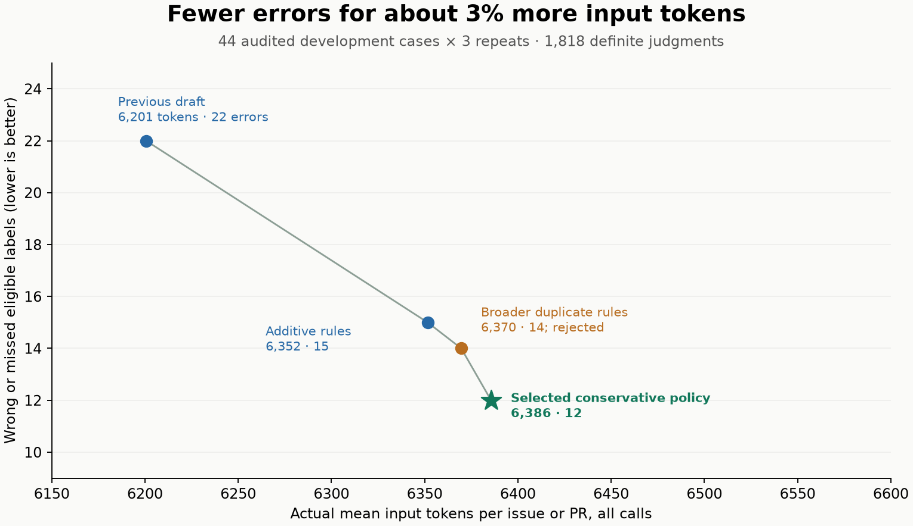

# Audited label references and marginal-cost improvement

The answer key needed correction. Re-auditing the 44 existing cases changed seventeen label judgments: **six previously definite answers were wrong, five uncertain judgments were resolved, and six previously definite judgments were made uncertain**. Ten judgments remain uncertain in that set. They are excluded from accuracy, not silently counted as correct. Subjective scope boundaries cannot honestly be certified as 100% accurate; the published reference distinguishes evidence-backed decisions from unresolved policy ambiguity. This is evaluation uncertainty only: production labeling remains fully automatic.

## Reference audit

Each case was checked against its frozen body, human discussion/reviews, changed-file evidence, related-item scope and the configured policy. Existing labels and bot comments are not ground truth. A live source check found all 34 real-case bodies unchanged; two titles had changed, so the original titles were retained for the matched replay. The full migration diff was inspected at its immutable commit: all 2,999 non-deleted files in the saved REST response match the audited head, while the REST list had omitted later files.

| Case                | Reference correction                                                                                                                                                                                 |
| ------------------- | ---------------------------------------------------------------------------------------------------------------------------------------------------------------------------------------------------- |
| #2930               | parity is positive: explicit upstream MCP alignment.                                                                                                                                                 |
| #2941               | docs is positive: website design-system presentation and undo state change.                                                                                                                          |
| #2949               | bug and needs reproduction are positive alongside feature: restores existing CLI confirmation behavior without a linked defect demonstration.                                                        |
| #2950               | bug, cli and chore are positive. The full diff includes public CLI implementation repairs and separate CI maintenance beyond the 3,000-file REST ceiling. Feature and reproduction remain uncertain. |
| #2915               | bug, cli and dependencies are positive: maintainer-confirmed dependency failure and explicit local upgrade tracking. Historical human removals affect ownership, not semantic eligibility.           |
| #2969               | duplicate is positive: its entire patch is identical to the earlier, broader open #2968.                                                                                                             |
| Synthetic 900106    | docs is uncertain: the fixture does not identify whether the fix changes installed component code or website code.                                                                                   |
| #2958, #2761, #2771 | reproduction remains uncertain at the static-presentation/reference versus runtime-defect boundary.                                                                                                  |

The previous report’s 13/1,584 result becomes **21/1,572 when the same archived responses are rescored** against the corrected references. That change is an answer-key correction, not a model improvement. A fresh three-repeat baseline below has twenty errors on the same corrected development decisions, reflecting one differing model judgment. Prior reports and local frozen reference files were preserved.

The [ground-truth ledger](label-ground-truth.csv) records all 672 label references across 48 cases, their source URLs, rationales and fixture hashes. It includes thirteen uncertain references: ten in the existing 44 cases, three in the four new confirmation cases. References were frozen before candidate inference; they were not revised to fit the outputs.

## Selected change

Keep one model request and the published, unchanged `@ieedan/label@0.0.1`. Follow same-repository references in human comments before incidental cross-references. Give release notes, manifests and source patches priority over generated registry data within the existing 100-file, 4,000-character patch and 24,000-character context limits. Independent reads remain bounded at four.

The policy clarifies mixed-scope defects, website presentation controls, evidence in release notes, maintainer-requested dependency upgrades, claimed work and independent internal maintenance. Duplicate rules, all thresholds and returned model probabilities are unchanged. Every configured bot-owned label can still be removed on later commits; human applications, other bots and incomplete ownership are preserved. No manual application or review gate is added.

## Matched cost and accuracy

All four final candidates ran on the same 44 audited cases three times: **132 item runs and 1,818 definite label decisions per candidate**. That set includes synthetic controls and reused diagnostic cases and was used for development, so its accuracy is not an estimate for the whole repository.

| Strategy                                | Mean input tokens/item, all 44 cases | False positives / misses | Errors | Wrong removals |
| --------------------------------------- | -----------------------------------: | -----------------------: | -----: | -------------: |
| Previous draft (07da873)                |                                6,201 |                   3 / 19 |     22 |              0 |
| Additive rules + prioritized evidence   |                                6,352 |                   3 / 12 |     15 |              0 |
| Broader duplicate rules, rejected       |                                6,370 |                   3 / 11 |     14 |              0 |
| Selected: conservative duplicate policy |                                6,386 |                   0 / 12 |     12 |              0 |

The selected point reduces errors **22 → 12** for **3.0% more input tokens** (6,201 → 6,386 per item). It lies on the empirical cost/error frontier of the matched full tests. The cheaper points trade accuracy for cost. Broader duplicate rules slightly improved the main cohort but produced three wrong duplicate judgments on #2905; the selected version retains the conservative policy and avoids that regression. There is no claim of a global optimum.

On the original 38-case budget-calibration composition, cost is **6,219 → 6,398** (+2.9%) and errors **20 → 12 out of 1,572**. The selected strategy remains 30.6% below the original deployed workflow’s 9,214-token mean budget, and also fits its 13,821-token +50% budget. Extra spending did not yield a preferable tested result. The original budget was measured on these 38 cases, not the additional confirmation cases.

Across the 44 cases, exact fully determined sets improve **91/105 → 96/105**. Wrong additions remain zero, missed additions fall 15 → 9, and definite stale-label cleanup improves **62/72 → 63/72**. There are no wrong removals or new false slop additions. Eligibility and mutation denominators differ because labels can already exist and ownership restricts removal.

## Separately frozen confirmation

Four newly scored real PRs (#2973, #2965, #2963, #2940) were manually annotated after selecting the candidate and before either version ran on them. Both versions were tested three times without subsequent tuning: **153/159 definite decisions are correct for each**. Nine uncertain repeated decisions are excluded. Both miss reproduction on #2973 and wrongly judge parity on #2965, three times each. This check shows no new accuracy gain, and no regression; it does not establish broad generalization. Both make three wrong parity additions and no wrong removals on this fresh set.

The distinction on #2965 is deliberate: explaining a Bits UI/Radix implementation mismatch does not itself establish the explicit shadcn/ui alignment required by the policy. #2973 repairs an unlinked runtime navigation target but supplies no original-defect demonstration. The unresolved review suggestion on closed #2963 and the internal-automation bug/reproduction boundary on #2940 are excluded. These references remain unchanged after inference.

Combined across all 48 cases, both versions score **1,977 definite decisions**; errors are **28 → 18**. This combined number mixes development and confirmation and should not replace their separate results. Mean tokens are **6,076 → 6,261** (+3.0%).

## Remaining selected-version errors and cleanup misses

Counts span three repeats. The four development misses are reproduction on #2939 and #2949, chore on #2950, and duplicate on #2969. The current collector does not retrieve the overlapping #2968 for #2969; the audited reference knows the relationship, while the model input lacks it. A broader search supplied that evidence but increased cost and introduced other errors, so it was not shipped.

| Case         | False positives | Missed eligible labels | Missed stale-label cleanup |
| ------------ | --------------- | ---------------------- | -------------------------- |
| public-2932  | —               | —                      | slop ×3                    |
| public-2939  | —               | needs reproduction ×3  | —                          |
| public-2949  | —               | needs reproduction ×3  | —                          |
| public-2917  | —               | —                      | duplicate ×3               |
| public-2950  | —               | chore ×3               | —                          |
| fresh-2969   | —               | duplicate ×3           | —                          |
| holdout-2905 | —               | —                      | duplicate ×3               |
| new-2973     | —               | needs reproduction ×3  | —                          |
| new-2965     | parity ×3       | —                      | —                          |

## Reproducibility

The paired [decision ledger](label-evaluation.csv) has all **4,032** rows, including negative decisions, probabilities and expected/actual additions and removals. Usage is actual provider-reported input tokens summed across every call; all calls resolved to `jev-1.14.0`. Every evaluation used the published CLI in dry-run mode with frozen GitHub responses and all GitHub writes blocked. The final production collector and adapter reproduced the evaluated request hashes on all 48 fixtures, with one inference request per fixture. The supplied key was entered through hidden input and was never saved in source or fixtures.

Failed pilots are excluded from the three-repeat frontier. Removing label descriptions saved tokens but worsened accuracy; broad searches and patch comparisons cost more without a preferable result; a shorter reproduction rule wrongly removed a valid label. The production implementation keeps none of that routing, extra inference or patch-comparison logic.

Latency is the CLI wall clock under frozen GitHub inputs, including Node startup and live inference, with two cases evaluated concurrently. It excludes live GitHub reads, installation and Actions queue time. No end-to-end speedup is claimed.

## Frozen case rationale

### dev

Fixture hash: `c3105f1a79e5018bf6d49bfac0683da3f6c055b596c1186af5c9f5fa6dec3bcc`.

- **public-2930:** New MCP feature/public CLI, manifests and MCP README; older #2777 explicitly closed in favor of it, so not duplicate. AUDIT: The body explicitly compares its MCP tools with upstream and closes the MCP parity request #2333. Under the explicit alignment rule parity is positive; the old negative was inconsistent with policy. Expected: cli, dependencies, docs, feature, parity.
- **public-2958:** Homepage styling regression fix, distinct from earlier card addition, so bug/docs and not duplicate. AUDIT: Homepage style repair clearly establishes bug/docs, but the policy boundary between static style consistency and runtime reproduction is not precise enough to certify this negative. No original-defect demo is explicitly supplied. Expected: bug, docs. Uncertain: needs reproduction.
- **public-2800:** New upstream Typeset feature and documentation port; later requesting maintainer thanks accepts the review response. No runtime defect needing reproduction. AUDIT: Retained after body, human discussion/reviews, changed-file and policy review; bot assertions were not evidence. Expected: docs, feature, parity.
- **public-2732:** New public Calendar range mode plus docs/examples and explicit upstream parity, linked to feature request #2735. AUDIT: Retained after body, human discussion/reviews, changed-file and policy review; bot assertions were not evidence. Expected: docs, feature, parity.
- **public-2919:** New end-user agent workflow/skill with documentation and explicit upstream port; no runtime defect. AUDIT: Retained after body, human discussion/reviews, changed-file and policy review; bot assertions were not evidence. Expected: docs, feature, parity.
- **public-2941:** Fixes Create undo, updates manifests/lockfile and internal dependency maintenance; no public CLI changes in the diff. AUDIT: The design-system provider and its state normalize visual radius/style controls on /create. This changes documentation-website presentation as well as fixing undo. Manifests/workspace build changes independently establish dependencies/chore. Expected: bug, chore, dependencies, docs.
- **public-2962:** Public CLI usage report; maintainer explains data-table intentionally is not installable, so no confirmed defect. Reporter explicitly denies AI description authorship. AUDIT: Retained after body, human discussion/reviews, changed-file and policy review; bot assertions were not evidence. Expected: cli.
- **public-2953:** Maintainer confirms CLI failure, supplies/accepts a package-manager workaround, and implements fix. Reproduction acceptance without a hosted project is uncertain. No direct evidence an AI wrote the description. AUDIT: Retained after body, human discussion/reviews, changed-file and policy review; bot assertions were not evidence. Expected: bug, cli, has workaround. Uncertain: needs reproduction.
- **public-2932:** Public CLI defect confirmed through maintainer fix #2947, accessible reproduction project. AI-assisted investigation disclosure does not establish AI description authorship. AUDIT: Retained after body, human discussion/reviews, changed-file and policy review; bot assertions were not evidence. Expected: bug, cli.
- **public-2931:** Fixes documentation website heading-font inheritance with demonstrated preview reproduction; AI investigation disclosure is not description authorship. AUDIT: Retained after body, human discussion/reviews, changed-file and policy review; bot assertions were not evidence. Expected: bug, docs.
- **public-2939:** Unconfirmed defect plus explicit new Combobox request. Reporter says animation patch works. No openable project is supplied; maintainer reapplies needs reproduction. No duplicate relationship. AUDIT: Retained after body, human discussion/reviews, changed-file and policy review; bot assertions were not evidence. Expected: feature, has workaround, needs reproduction.
- **public-2944:** Native select ref type defect confirmed through maintainer fix #2945, specific usable patch. Whether the step-only reproduction has been accepted is uncertain. AUDIT: Retained after body, human discussion/reviews, changed-file and policy review; bot assertions were not evidence. Expected: bug, has workaround. Uncertain: needs reproduction.
- **public-2928:** Adds a public component export, fulfilling #2927, not duplicating it. Implementation alone is not docs. AUDIT: Retained after body, human discussion/reviews, changed-file and policy review; bot assertions were not evidence. Expected: feature.
- **public-2929:** Repairs existing InputOTP state styling and aligns with upstream attribute behavior, fixes #2924. AUDIT: Retained after body, human discussion/reviews, changed-file and policy review; bot assertions were not evidence. Expected: bug, parity.
- **public-2926:** Adds public AI elements primitives, docs/examples, dependency manifests and explicit upstream alignment; fixes #2925, not duplicate. AUDIT: Retained after body, human discussion/reviews, changed-file and policy review; bot assertions were not evidence. Expected: dependencies, docs, feature, parity.
- **public-2947:** Public CLI bug fix, linked #2932. No package dependency or documentation content changes. AUDIT: Retained after body, human discussion/reviews, changed-file and policy review; bot assertions were not evidence. Expected: bug, cli.
- **public-2949:** New public CLI flags/noninteractive behavior, docs updates and actual dependency changes; prerequisite for MCP is not duplicate. AUDIT: Besides new flags, apply restores confirmation that -y was meant to skip: an existing runtime behavior fix. Feature and bug can coexist. No linked issue or demonstration of that defect is supplied; #2930 is a feature PR, not a defect reproduction. Expected: bug, cli, dependencies, docs, feature, needs reproduction.
- **public-2959:** New public preset support and documentation, explicitly upstream chart/preset parity. Review requests have later concrete resolution replies from the maintainer/author. AUDIT: Retained after body, human discussion/reviews, changed-file and policy review; bot assertions were not evidence. Expected: cli, docs, feature, parity.
- **public-2771:** Adds upstream composition/API docs and corrects invalid examples. Static reference corrections alone do not require reproduction. AUDIT: Composition/API/reference updates plus a runnable progress-label accessibility correction establish docs/parity/bug. Static reference versus runtime reproduction boundary is ambiguous for that example; the old definite negative was too strong. Expected: bug, docs, parity. Uncertain: needs reproduction.
- **public-2914:** Adds upstream changelogs/demos; author clarified distinct scope and maintainer accepted. Existing component implementation does not duplicate changelogs. AUDIT: Retained after body, human discussion/reviews, changed-file and policy review; bot assertions were not evidence. Expected: docs, parity.
- **public-2917:** Docs alias correction; already claimed by #2864. A request and its implementation are distinct, not duplicates. No maintainer-confirmed runtime defect. AUDIT: Retained after body, human discussion/reviews, changed-file and policy review; bot assertions were not evidence. Expected: docs.
- **public-2761:** Fixes broken homepage rendering/layout and docs presentation, explicitly aligned upstream. Renaming CLI tab is not public CLI code. AUDIT: Homepage visibility/layout repairs establish bug/docs/parity. Whether this presentation-only change requires a runtime demonstration is an unresolved policy boundary; exclude rather than certify the old negative. Expected: bug, docs, parity. Uncertain: needs reproduction.
- **public-2736:** Internal deployment/release tooling and actual dependency upgrade; Changesets CLI is not the public shadcn-svelte CLI. AUDIT: Retained after body, human discussion/reviews, changed-file and policy review; bot assertions were not evidence. Expected: chore, dependencies.
- **public-2950:** Documentation and real package dependency migration. Independent internal CI maintenance scope is uncertain; no public CLI package changes. AUDIT: Full immutable diff 6149e141...1adfa8b3, beyond the 3000-file REST ceiling, changes three public CLI implementation files and fixes generated TypeScript paths/duplicate extensions. CI adds a separate Node memory setting. Docs/dependencies remain positive. New capability versus compatibility repair, and runtime reproduction applicability, remain ambiguous. The earlier no-CLI reference was factually wrong. Expected: bug, chore, cli, dependencies, docs. Uncertain: feature, needs reproduction.
- **control-900101:** Targeted control: Dropdown hover report repeated AUDIT: Retained after body, human discussion/reviews, changed-file and policy review; bot assertions were not evidence. Expected: duplicate.
- **control-900102:** Targeted control: feat: add custom item rendering snippet AUDIT: Retained after body, human discussion/reviews, changed-file and policy review; bot assertions were not evidence. Expected: duplicate, feature.
- **control-900103:** Targeted control: feat: add a timezone mode AUDIT: Retained after body, human discussion/reviews, changed-file and policy review; bot assertions were not evidence. Expected: feature, slop.
- **control-900104:** Targeted control: feat: add timezone rendering prop AUDIT: Retained after body, human discussion/reviews, changed-file and policy review; bot assertions were not evidence. Expected: feature.
- **control-900105:** Targeted control: fix: restore spinner visibility AUDIT: Retained after body, human discussion/reviews, changed-file and policy review; bot assertions were not evidence. Expected: bug, needs reproduction.
- **control-900106:** Targeted control: fix: restore spinner visibility AUDIT: The synthetic fixture supplies no changed files and does not say whether it changes installed component code or the website. The official demo establishes reproduction, but cannot establish a definite docs-negative. Exclude that ambiguous label; do not pretend the old reference was certain. Expected: bug. Uncertain: docs.
- **control-900107:** Targeted control: chore: maintain unit tests AUDIT: Retained after body, human discussion/reviews, changed-file and policy review; bot assertions were not evidence. Expected: awaiting submitter, chore.
- **control-900108:** Targeted control: chore: maintain unit tests AUDIT: Retained after body, human discussion/reviews, changed-file and policy review; bot assertions were not evidence. Expected: chore.

### latest

Fixture hash: `29a41a69e413971258d4daa728e4dddb2368a475c6d2b9b177e840c9eedfe5a0`.

- **fresh-2967:** Repairs existing Typeset website presentation and explicitly aligns toolbar/tooltips with shadcn: bug, docs and parity. Existing helper showOnDesktop is reused, not a new consumer API. Unlinked runtime UI fixes have no supplied accessible demonstration of the original defect: needs reproduction. AUDIT: Retained after body, human discussion/reviews, changed-file and policy review; bot assertions were not evidence. Expected: bug, docs, needs reproduction, parity.
- **fresh-2968:** Fixes documentation preview layout/images and dropdown runtime animations, explicitly restoring missing upstream images: bug, docs, parity and needs reproduction. No linked issue or original-defect reproduction is supplied. Broader preview fixes are distinct from the narrower animation-only PR, so this PR is not redundant. AUDIT: Retained after body, human discussion/reviews, changed-file and policy review; bot assertions were not evidence. Expected: bug, docs, needs reproduction, parity.
- **fresh-2969:** Restores existing preview-menu animations to match shadcn: bug, docs, parity and needs reproduction. No linked issue or accessible original-defect demonstration. Its complete patch also appears in the current head of #2968, but canonical ownership and when that overlap arose are unclear: duplicate is uncertain, not assumed false. AUDIT: The entire one-file patch is byte-identical to the same file patch in the earlier open #2968, created 35 minutes earlier. #2968 explicitly covers the same missing preview animations plus other changes. #2969 was closed unmerged; no requested replacement or distinct scope is evidenced. Expected: bug, docs, duplicate, needs reproduction, parity.
- **fresh-2970:** Repairs documentation heading scroll behavior and explicitly compares/alines with upstream shadcn: bug, docs and parity. Local fixed browser-fixture validation is not an accessible reproduction of the original defect; no linked issue, so needs reproduction. AUDIT: Retained after body, human discussion/reviews, changed-file and policy review; bot assertions were not evidence. Expected: bug, docs, needs reproduction, parity.
- **fresh-2971:** Fixes registry-template installation imports and links defect #2935: bug, without needs reproduction. CLI files contain regression tests only, not a change to the public CLI. Registry implementation and associated regression tests alone are not separate docs or chore scope. Separate page-target fix #2972 and linked report are not duplicates. AUDIT: Retained after body, human discussion/reviews, changed-file and policy review; bot assertions were not evidence. Expected: bug.
- **fresh-2972:** Fixes registry page targets and documentation examples, linked to defect #2934: bug and docs, without needs reproduction. Only CLI regression tests change under packages/cli; no public CLI implementation, dependency or feature change. Companion import fix #2971 has distinct scope. AUDIT: Retained after body, human discussion/reviews, changed-file and policy review; bot assertions were not evidence. Expected: bug, docs.

### confirm

Fixture hash: `23fef248344aba72eb8fc625384cd8d21aec474ff8e22e6952692fa499ee5711`.

- **holdout-2915:** Maintainer explicitly retains local dependency-upgrade tracking despite upstream cause, so not duplicate or a new feature. Generic npm advice is not a demonstrated workaround. Human removals and later bot reapplications make bug/cli/dependency ownership intent versus classification uncertain, as is accepted reproduction after diagnosis; exclude these judgments rather than infer ground truth from model output. All other labels are definite negatives. AUDIT: Maintainer validates the peer mismatch, explicitly retains local upgrade tracking and later identifies the fix. The report concerns the public CLI and the requested dependency upgrade. Historical human removals govern mutation ownership, not semantic eligibility. Reproduction acceptance remains ambiguous; keep it excluded. Expected: bug, cli, dependencies. Uncertain: needs reproduction.
- **holdout-2905:** Fixes component alignment and links defect #2902: bug, not a duplicate of the report or documentation content. A maintainer requests a different fix location, but PR is closed without an explicit response; awaiting submitter is uncertain. No explicit author claim of upstream alignment. AUDIT: Retained after body, human discussion/reviews, changed-file and policy review; bot assertions were not evidence. Expected: bug. Uncertain: awaiting submitter.
- **holdout-2908:** Maintainer explicitly accepts and merges the local Field.Title data-slot fix for #2635 despite upstream not fixing it. Bug; not a duplicate, docs, feature, or parity port. Linked defect removes reproduction need. AUDIT: Retained after body, human discussion/reviews, changed-file and policy review; bot assertions were not evidence. Expected: bug.
- **holdout-2964:** Docs plus explicit upstream alignment, and new installed Drawer.Root/NestedRoot showSwipeHandle API and direction data attributes. Feature/docs/parity; porting and existing primitive reuse do not negate the new public API. No described runtime defect requiring reproduction. No dependency manifest changes. AUDIT: Retained after body, human discussion/reviews, changed-file and policy review; bot assertions were not evidence. Expected: docs, feature, parity.

### sanity

Fixture hash: `f7e97b36832ef6a7bc7a6ee1d78915746860e16f1f49f851326d6f6ffd161416`.

- **sanity-900201:** Positive unclaimed wording correction AUDIT: Retained after body, human discussion/reviews, changed-file and policy review; bot assertions were not evidence. Expected: contributions welcome, docs.
- **sanity-900202:** Exact wording correction already claimed in a linked implementation PR AUDIT: Retained after body, human discussion/reviews, changed-file and policy review; bot assertions were not evidence. Expected: docs.

### fresh

Fixture hash: `37a55cb73b7bf3592edd126c7956f616f27b3b2b1df5884c1b3d6eb07665118f`.

- **new-2973:** The missing #blocks scroll target repairs an existing navigation defect; styling/category visibility and static navigation links are docs presentation, with explicit shadcn alignment. The fixed-branch prerender check is not a demonstration of the original defect. No installed component API, dependency, public CLI implementation or separate internal maintenance changes. Expected: bug, docs, parity, needs reproduction.
- **new-2965:** The complete one-file installed Tooltip implementation diff repairs arrow positioning. Only a screenshot is supplied, with no linked issue or runnable original-defect demo. Comparing Bits UI and Radix internals does not explicitly establish shadcn/ui parity under the policy; no documentation or public API is added. Expected: bug, needs reproduction.
- **new-2963:** The data-table documentation calls an undefined getPayments; adding the typed sample implementation fixes the runnable example and explicitly follows shadcn/ui docs. The linked issue comment establishes the reported defect. The closed-PR maintainer suggestion of a blank array is ambiguous as a still-outstanding request; exclude awaiting submitter. Expected: bug, docs, parity. Uncertain: awaiting submitter.
- **new-2940:** Only internal GitHub workflow dispatch/automation changes. No package manifest/lockfile or public CLI/component/docs changes. Whether enabling bot-triggered reproduction comments is a new internal capability or an existing runtime defect, and whether runtime reproduction policy applies to that automation, is ambiguous; exclude those two labels. Expected: chore. Uncertain: bug, needs reproduction.
